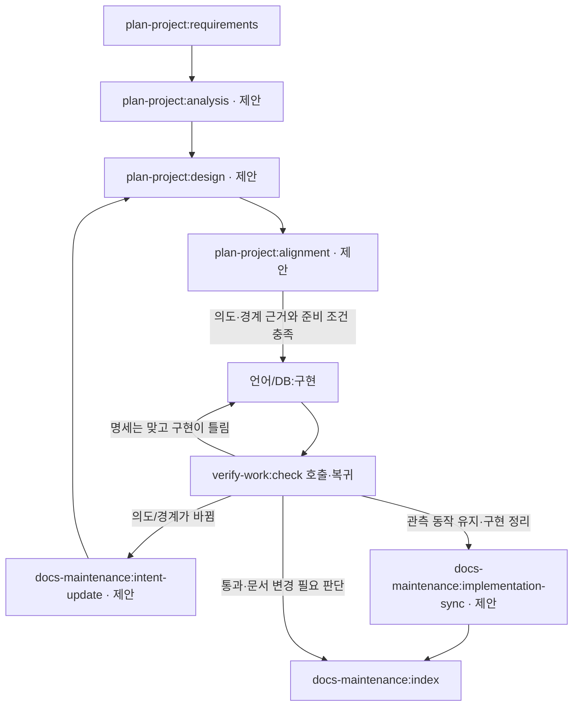

# SPDD·REASONS로 docs와 하네스를 보완하는 설계 조사

2026-10-31. 상태: 원문 조사·현재 구조 대조·반영 제안. 아래 제안 라우트·준비 조건·문서 양식은 아직 활성 구현이 아니다.

**판단:** 현재 하네스는 절차의 이동·검증·근거 연결을 관리한다. 여기에 코드 작성 전 의도·개념·책임·변경 경계를 검토할 설계 계약을 연결하는 것이 유효하다. docs 스킬에 일곱 제목을 추가하는 것만으로는 부족하다. 계획 스킬이 설계 내용을 만들고 검토하며, docs는 정본·변경 방향·인덱스를 관리하고, flow는 구현 진입 조건을 확인해야 한다.

## 1. 확인한 원문과 공개 도구의 범위

SPDD는 Structured Prompt-Driven Development다. Thoughtworks 내부 IT의 경험을 Wei Zhang·Jessie Jie Xia가 Martin Fowler 사이트에 발표한 방법이다. 연결된 공개 도구는 저자 계정의 OpenSPDD다. 회사 명의의 독립 제품/표준으로 확대 해석하지 않는다. 글은 2026-04-28 공개, Q&A는 2026-05-04 추가 표기를 확인했다. [발표 원문](https://martinfowler.com/articles/structured-prompt-driven/)

원문의 실천 기준은 구현 전에 가치·범위·용어·수용 조건을 맞추는 것이다. 경계에 관한 결정을 생성 코드에서 뒤늦게 추정하지 않게 한다. [Alignment](https://martinfowler.com/articles/structured-prompt-driven/alignment.html)

설계 검토에는 요구와 도메인 모델, 구성요소 책임/의존성, 실행 가능한 작업, 강한 제약이 함께 필요하다. 단순 작업 목록의 존재만으로 준비됐다고 보지 않는다. [Abstraction first](https://martinfowler.com/articles/structured-prompt-driven/abstraction-first.html)

조사한 OpenSPDD 기준 commit은 `3991ffa2cd6670fdb6f329ca62799ccb96d0e7d9`, commit 시각은 2026-09-29T02:19:47Z다. GitHub API의 당시 main metadata/commit 응답으로 확인했다. [저장소](https://github.com/gszhangwei/open-spdd)와 [라이선스 원문](https://github.com/gszhangwei/open-spdd/blob/main/LICENSE)은 MIT로 표시되며, 실제 LICENSE의 저작권/조건도 읽었다. 라이선스 문구를 대량 이식한 것은 아니다.

고정 commit의 analysis·canvas·generate·sync 템플릿과 generate.go 진입점을 읽었다. prompt-update는 해당 SHA의 raw 접근이 실패해 **article이 연결한 v0.4.9와 현재 main** 원문으로 따로 확인했다. LICENSE·README와 design-philosophy도 main 확인이며 고정 SHA의 동일 파일 검증으로 표시하지 않는다. 전체 tree API와 일부 raw/출력 전략 파일은 접근에 실패했다. 따라서 전체 소스 감사·설치 성공·모든 도구 호환성을 주장하지 않는다. CLI를 설치/실행하거나 외부 템플릿을 현재 지침으로 적용하지 않았다.

검토한 CLI 생성 진입점은 템플릿 선택·파일 생성 전략을 호출한다. 이를 우리 flow의 실행 상태/증거 판정과 같은 기능으로 간주하면 안 된다. README의 Codex 출력/명시 호출 설명은 upstream의 설명이며 이 호스트에서 실행 확인한 결과가 아니다. [고정 generate.go](https://github.com/gszhangwei/open-spdd/blob/3991ffa2cd6670fdb6f329ca62799ccb96d0e7d9/cmd/generate.go)

## 2. REASONS가 담아야 하는 것

`REASONS`는 일곱 설계 관점을 묶은 이름이다. 기존 flow의 `reason`은 특정 이동의 사유다. 둘은 역할이 다르며 어느 하나로 다른 하나를 대체하지 않는다.

| 관점 | 코드 전에 답할 질문 | 이 하네스에 연결할 내용 |
|---|---|---|
| Requirements | 누구의 어떤 문제이며 무엇을 수용할 것인가 | Charter/마일스톤/R ID·성공 조건·제외 범위·요구의 출처 |
| Entities | 핵심 개념·관계·소유/수명은 무엇인가 | 프로젝트 용어·상태·권한 주체·불변식 |
| Approach | 어떤 방향을 택하며 왜 대안을 제외했는가 | 선택·대안·절충·전제·재검토 조건 |
| Structure | 책임과 의존 경계는 어디인가 | 컴포넌트·API/데이터·트랜잭션/신뢰 경계·허용 변경 위치 |
| Operations | 어떤 결과 단위로 구현·검증할 것인가 | O ID·입력·선행 조건·산출물·수용 기준·검사 연결 |
| Norms | 일관되게 따라야 할 공통 규칙은 무엇인가 | 기존 AGENTS·언어/보안 스킬의 필요한 정본 링크와 작업별 추가 규칙 |
| Safeguards | 유지해야 할 경계와 실패 조건은 무엇인가 | 금지/고정 조건·호환성·성능/비용·복구·접근 권한·증명할 방법 |

위 일곱 관점과 의도→설계→실행→통제의 관계는 발표 원문의 정의다. 표의 하네스 배치는 이 조사에서 제안한다. [REASONS 정의](https://martinfowler.com/articles/structured-prompt-driven/#the-reasons-canvas)

설계 문서는 한 기능을 이해하고 검토할 수 있는 크기로 만든다. 모든 관점은 검토하되 영향 없는 항목에는 이유와 기존 정본을 연결한다. 빈 제목을 채우려고 새 객체·API·요구를 만들지 않는다. 막는 미결정과 그 작업을 막지 않는 미결정을 구분한다. 이 경량화/미결정 처리는 우리 하네스용 조정안이다.

## 3. OpenSPDD에서 채택할 절차와 조정할 부분

| 원문/실제 템플릿 | 확인한 기능 | 채택할 판단 | 조정할 부분 |
|---|---|---|---|
| [analysis](https://github.com/gszhangwei/open-spdd/blob/3991ffa2cd6670fdb6f329ca62799ccb96d0e7d9/internal/templates/data/core/spdd-analysis.md) | 요구·도메인 개념·전략·위험/갭을 먼저 분석 | 왜/무엇과 상세 구현을 나누고 실제 코드에서 근거 확보 | 원문 전체 재복제·고정 탐색 hop·Jira 파일명·단계마다 확인 질문을 의무화하지 않음 |
| [reasons-canvas](https://github.com/gszhangwei/open-spdd/blob/3991ffa2cd6670fdb6f329ca62799ccb96d0e7d9/internal/templates/data/core/spdd-reasons-canvas.md) | 일곱 관점·실행 작업·제약의 구현 전 명세 | 검토 가능한 설계 계약·작업별 완료 확인 | Java 상속/DAO/예외 처리 예제·모든 메서드 상세 명세·일곱 섹션 완전 확정을 모든 작업에 강제하지 않음 |
| [generate](https://github.com/gszhangwei/open-spdd/blob/3991ffa2cd6670fdb6f329ca62799ccb96d0e7d9/internal/templates/data/core/spdd-generate.md) | Operations 순서·규범·제약에서 코드 생성 | 합의한 순서/경계를 보존하며 관련 부분만 구현 | 컴포넌트별 전체 생성 후 일괄 검증을 유일한 분해로 삼지 않음. 기능 묶음별 현재 검증을 유지하고 자동 commit 규칙도 가져오지 않음 |
| [prompt-update](https://github.com/gszhangwei/open-spdd/blob/v0.4.9/internal/templates/data/core/spdd-prompt-update.md) | 변경에 영향받는 섹션만 갱신·상호 일관성 확인 | 요구/경계 변경은 그 정본을 먼저 갱신 | 매번 코드 재생성 허락을 새로 묻는 흐름을 복사하지 않음 |
| [sync](https://github.com/gszhangwei/open-spdd/blob/3991ffa2cd6670fdb6f329ca62799ccb96d0e7d9/internal/templates/data/core/spdd-sync.md) | 코드 변화에서 설계의 구현 설명을 최신화 | 책임·관계·실제 이름/시그니처를 증분 반영 | 현재 구현에 맞춰 요구·Safeguards를 낮추는 자동 동기화를 금지 |

추가적인 주의점:

- 분석 템플릿에는 개념 중심의 좁은 코드 탐색과 관련 의존 확인이 있다. 기존 index → 정본의 관련 절 → 필요한 경계 검색에 접목한다. 다만 `.env`를 예시처럼 읽어 비밀값을 연구 문서에 복제하지 않는다.
- canvas는 기존 단순 구조를 보존하라는 지침과 Java 중심 계층/인터페이스 예제를 함께 갖고 있다. 후자를 Svelte/Python/PostgreSQL의 필수 구조로 옮기면 과설계가 생길 수 있다.
- 순수 시각 탐색·일회성 수정·탐색 실험에는 먼저 필요한 의도/경계만 짧게 기록한다. 광범위한 영구 명세 작업으로 바꾸지 않는다. 원문 역시 적용 비용과 상황 차이를 인정한다.
- 예제의 약99% 정렬 주장은 우리 하네스의 실측 지표가 아니다. 373개 제어/하네스 회귀도 제품 요구가99% 이해됐다는 증거가 아니다.
- 원문의 기능 검증 뒤 unit test 단계는 사례의 순서다. 여기서는 수용 기준과 테스트 판단 기준을 구현 전에 정하고, 위험/회귀 검사는 구현 중에도 수행한다. 틀린 구현에서 기대값을 역생성해 둘 다 통과시키지 않는다.
- 도구가 만든 전체 SPDD 스킬 묶음을 설치하면 기존14개 스킬과 소유권·선택·승인 정책이 겹칠 수 있다. 우선 기존 스킬에 판단/참조를 얇게 통합하는 방안을 권한다.

## 4. 현재 하네스와의 대조

| 현재 자산 | 이미 있는 강점 | REASONS 관점의 보완점 |
|---|---|---|
| [프로젝트 진행](../../../.agents/skills/plan-project/references/project-lifecycle.md), [계획 양식](../../../.agents/skills/plan-project/assets/project-plan.md) | 사람이 정한 Charter·경계·마일스톤, 요구·성공 조건·갭·task 연결 | Entities/Approach/Structure를 함께 검토하는 상세 설계 계약·검토 결과의 연결 |
| [docs 스킬](../../../.agents/skills/docs-maintenance/SKILL.md), [최신화](../../../.agents/skills/docs-maintenance/references/synchronization.md) | 구현 사실과 요구 권위 구분, 양방향 대조·증분 편집 | 요구→설계→코드와 코드→구현 설명의 서로 다른 변경 경로를 명시적으로 연결 |
| [위키](../../../.agents/skills/docs-maintenance/references/wiki.md), [인덱스](../../../.agents/skills/docs-maintenance/references/navigation.md) | 출처·주장 상태·계층적 선택 읽기·정본 분리 | 코드 전에 읽을 설계 계약·적용 O ID·관련 검토의 정본 경로 |
| [plan 라우트](../../../.agents/skills/plan-project/routes.toml) | 요구와 계획을 artifact로 검토 | 분석/상세 설계/의도 정렬이라는 서로 다른 판단이 같은 계획에 뭉쳐 있음 |
| [Python 라우트](../../../.agents/skills/python-backend/routes.toml) 등 | 구현 후 verify 호출·증거·문서/인덱스 정리 | 현재 필수 입력은 request뿐. 코드 전 최신 설계와 정렬 근거를 요구하지 않음 |
| [flow catalog](../harness/flow_catalog.py), [flow 상태](../harness/skill_flows.py) | 순서·조건·호출/복귀·현재 근거·절차 변경·반복 한도 검사 | 준비된 설계/정렬 근거의 의미와 버전 일치 검사가 별도 필요 |
| [design-first](../../../.agents/skills/design-first/SKILL.md) | UI 디자인 시스템·토큰·화면 계약 | 이름만 보고 서비스/도메인 아키텍처의 범용 설계 스킬로 사용하면 안 됨 |
| [검증 리뷰](../../../.agents/skills/verify-work/references/review.md), [evidence](../harness/evidence.py) | 요구와 결함 분리·실제 check/회귀·기준별 리뷰 | 설계 단계에도 요구→작업→수용 조건의 빠짐과 미결정 범위를 확인할 검토 산출물 필요 |

다음은 현재 코드를 격리 사본에서 실행해 확인한 관측이다. 현재 작업 폴더의 실제 프로젝트를 바꾸지 않았다.

| 확인 사례 | 실제 결과 | 해석 |
|---|---|---|
| 설계/정렬 artifact 없이 Python 구현 start | running, steps 진입 | 구현 전 설계 입력을 기계적으로 요구하지 않음 |
| 같은 조건의 Svelte 구현 start | running, steps 진입 | UI도 request 외의 선행 정렬 artifact는 없음 |
| 같은 조건의 PostgreSQL change start | running, steps 진입 | 데이터 경계 변경도 같은 상태 |
| 내용이 `Reviewed.`뿐인 artifact로 plan의3절차·passed 기록 | 기계적 검증 허용 | 파일/해시/절차는 확인하나 설계 충실도는 에이전트 판단임 |

전체27개 노드의 입력 집합은 request 하나이고 guard는 validated/failed다. 위 결과는 이전 그래프 계약의 결함 재현이 아니라 **새로 요구하는 설계 준비 조건이 아직 없다는 확인**이다. artifact의 존재나 passed 표지만으로 의미적 합의를 보장하지 않는 기존 한계와 일치한다. 관측 원본은 이 조사 task의 PROBE 증거에 연결한다.

## 5. 책임과 문서 정본의 제안

스킬14개는 유지한다. REASONS의 글자마다 새 스킬을 만들거나 모든 절차를 docs로 합치지 않는다.

| 소유자 | 맡을 것 | 유지할 경계 |
|---|---|---|
| plan-project | 의도/도메인 분석, 상세 설계 계약, 대안/미결정, Operations 분해·준비 판단 | 제품 선택은 사용자 요청·기존 결정에서 도출. UI 디자인 규칙을 대신하지 않음 |
| docs-maintenance | 설계 문서 보존·버전/원문 연결·변경 분류·최신화·위키/인덱스 | 무엇이 올바른 제품 요구인지 현재 코드에서 자동 추정하지 않음 |
| research / experiment | 설계 선택의 원문·반증·필요한 실측 | 탐색 결과를 채택된 결정으로 자동 승격하지 않음 |
| design-first / 언어 / postgres / security-review | 해당 경계의 상세 계약·검증 방법 | 공통 규칙을 Canvas에 전문 복제하지 않음 |
| verify-work | 구현 전 설계 검토와 구현 후 실제 수용/회귀 대조 | 파일 형식 통과와 의미 판단·독립 평가를 구분 |
| maintain-knowledge | 반복해 검증한 조건부 교훈의 catalog | 기능 명세·작업 상태의 별도 정본을 만들지 않음 |
| flow·task/evidence | 진입 조건·버전·허용 이동·실제 위치와 증거 확인 | 자동 의미 판정이나 모델 외부 파일 쓰기 통제기로 확대하지 않음 |

프로젝트 문서는 기존 구조에서 다음처럼 연결할 수 있다. 이것은 배치 제안이며 빈 폴더/문서 생성을 요구하지 않는다.

```text
docs/projects/<project>/
  index.md                   질문·단계 → 관련 정본과 적용 범위
  brief.md                   Charter·마일스톤·요구 정본의 출발점
  design/<feature>.md        필요한 REASONS 관점과 기존 정본 링크
  plan.md                    필요할 때만 요구/갭·O ID/task 연결
  security.md                현재 필수 보안 문서
  wiki/...                   출처가 있는 재사용 지식; 설계/실측 원문으로 연결

docs/tasks/<task>/
  task.json                  실제 목표·수용 기준·증거 ID
  notes.md                   진행·실패·결정 맥락
  review.json                완료 검토
```

작으면 brief 안에 REASONS 절과 Operations를 둘 수 있다. 이미 설계/ADR/계약이 있으면 새 Canvas에 복사하지 않고 그 정본을 참조한다. N/S의 공통 규칙은 해당 스킬·security 문서 링크와 작업별 추가 제약으로 표현한다. 구조가 큰 기능만 별도 설계 파일로 나눈다.

## 6. 의도 정렬은 결정 근거와 준비 조건으로 확인한다

제안하는 연결은 다음과 같다.

`Charter·마일스톤 → 요구/R ID → 분석·대안 → REASONS 설계 → O ID → task 수용 기준 → 실제 검사/리뷰 → 잔여 갭·설계/문서 갱신`

**의도 정렬을 매번 새 승인 버튼으로 만들지 않는다.** 현재 요청이 구현까지 맡겼고 기존 결정이 충분하면 그 원문을 근거로 정렬 상태를 기록할 수 있다. 결과를 바꾸는 미확정 범위·도메인 의미·권한·대안 선택이 남았을 때만 질문한다. 질문은 영향·선택지·추천 이유를 담고 답변이 필요한 경로는 기다린다. 이미 승인된 동작을 재확인하지 않는다.

설계 검토 결과에는 최소한 다음 관계가 필요하다. 아래 키는 논리적 항목이며 현재 CLI가 받는 필드라고 주장하지 않는다.

- 설계 계약의 정본 경로와 실제 내용 해시.
- 요구/R ID·상위 목표/현재 요청·관련 결정의 원문 위치.
- 포함/제외 범위·허용 변경 위치와 보호할 계약.
- 관련 E/A/Structure와 불변식·예상 오류/복구·실행 환경.
- O ID → 요구/수용 기준 → 검증 방법/근거의 대응. 아직 실행 전인 검사는 계획임을 표시.
- 중요한 선택의 상태: 사용자 결정 / 기존 승인 재사용 / AI 제안 / 판단에 영향 없는 미결정 / 현재 작업을 막는 미결정.
- 검토한 사람/에이전트·근거·판정과 적용 범위. 실제 독립성을 별도로 표시.

구현 라우트의 `design`, `alignment` 같은 이름 입력에 기존 artifact ID를 묶는 기반은 이미 있다. 그러나 **이름과 파일만 추가해서는 부족하다.** 지정한 artifact가 설계 계약인지, 검토가 그 내용 해시를 가리키는지, 관련 요구/O ID가 존재하는지, blocking 미결정이 없는지 확인할 제한된 형식 검증이 필요하다. 기존 strict JSON·canonical path·크기 제한·hash/evidence 검증을 재사용한다.

준비 조건은 다음 모든 경로에 적용해야 한다.

1. 현재 노드를 새로 만드는 공통 진입점에서 검사하여 start·move·restart를 함께 다룬다.
2. call 대상이 구현 라우트인 경우도 동일하게 검사한다.
3. 검토한 계약이 바뀌면 그 검토 근거를 그대로 재사용하지 않는다.
4. `reason`이나 단순 `validated` 라벨로 준비 조건을 우회하지 않는다.
5. 일반 편집/탐색과 행동·API·권한·데이터 경계 변경의 프로필을 구분하고 제외 사유를 남긴다.

이 형식 검증도 설계가 비즈니스적으로 옳다는 자동 증명은 아니다. 올바른 요구 해석·대안 선택은 사람/에이전트가 원문에서 판단한다. flow API 밖의 임의 코드 편집까지 OS 수준으로 막는 기능과도 구분한다.

## 7. 제안하는 라우트와 반복 구조

아래 `analysis`, `design`, `alignment`, `intent-update`, `implementation-sync`는 **신규 제안 이름**이다. 현재 활성27개 라우트의 존재로 오해하지 않는다.



도식은 책임/피드백 관계다. 실제 call은 검증 결과를 호출자의 판정 위치로 돌려주며 전역 graph 이동과 혼동하지 않는다. 사용자 결정이 필요하면 기존 user_choice로 분기한다. 설계·준비 조건을 표현하려고 세 가지 when 조건이나 call/transition 의미를 새로 정의할 필요는 없다.

필요한 보완은 기존 계획 범위의 분석/설계 라우트, docs의 변경 분류/동기화 연결, 진입 시 제한된 준비 검사다. 검토 결과를 task/evidence로 연결하며 다른 상태 장부를 추가하지 않는다.

## 8. 변경 종류에 따라 돌아갈 위치를 구분한다

| 관측한 변경/실패 | 먼저 대조할 정본 | 다음 행동 |
|---|---|---|
| 사용자 요구·권한·관측 가능한 동작·성공 조건이 바뀜 | 원문 결정 → 관련 REASONS 절과 경계 | 필요한 선택을 확인하고 영향받은 설계/O ID를 먼저 갱신한 뒤 관련 코드/검사 수정 |
| 합의한 명세는 충분하고 구현만 위반 | 현재 명세·불변식과 실제 실패 | 요구를 바꾸지 않고 재현→좁은 코드 수정→관련 회귀. 설명의 누락이 있다면 해당 설명만 보완 |
| 이름/내부 책임/구조 정리이며 관측 동작은 유지 | 기존 의도·동작 계약과 관련 회귀 | 허용된 작은 리팩터링 후 E/Structure/O의 구현 설명을 최신화 |
| 설명/링크가 틀림 | 실제 결정·코드/검사 원문 | 문서·인덱스만 필요한 범위에서 수정 |
| 기존 코드와 요구가 모순되나 어느 쪽이 맞는지 미결 | 결정 권위·날짜·원래 수용 기준 | 일치시키기 위해 임의로 명세를 낮추지 않고 필요한 결정을 분리 |

이 구분은 원문의 prompt-first/code-first 양방향 흐름을 우리 정본 체계에 적용한 판단이다. [Iterative Review](https://martinfowler.com/articles/structured-prompt-driven/iterative-review.html)의 범위·동작·책임 검토를 활용한다. 원문의 sync 템플릿은 실제 코드에서 behavioral·validation·Safeguards도 갱신할 수 있게 안내하므로, 여기서는 변경 권한과 결정 근거를 추가로 확인해야 한다.

## 9. docs 스킬에 구체적으로 보완할 내용

새 최상위 SPDD 스킬보다는 다음 참조/라우트 보완이 적절하다.

- 공통 흐름1~3단계에서 현재 문서의 역할을 요구·설계 계약·구현 사실·실측·위키로 구분하고 정본을 확인한다.
- 코드 전 설계 문서는 plan-project의 REASONS 절차로 연결한다. docs는 요구/설계 내용을 독자적으로 발명하지 않는다.
- synchronization에 앞 표의 변경 분류와 명세/구현 중 어느 쪽을 먼저 갱신할지 판단을 연결한다.
- 관련 설계의 R/O/불변식 변경이 생기면 consumer task·검토 근거·검사·인덱스의 영향을 따라간다.
- 위키 ingest에서는 채택한 의도·대안의 탈락 이유·재검토 조건을 정본으로 연결한다. 설계 초안이나 실패 결과를 현재 요구로 자동 채택하지 않는다.
- validation에 요구→설계→O→검사 대응과 코드 전 검토/구현 후 증거를 나누어 확인한다.
- index에는 기능·질문·단계에서 설계 정본/관련 O/근거를 찾는 링크를 둔다. 모든 Canvas·wiki 본문을 context.documents에 강제 등록하지 않는다.

토큰 효율은 작은 전체 지도 → 해당 기능의 설계/계약 → 이번 O와 관련 규칙·근거로 유지한다. 정합성 검토 때는 필요한 REASONS 절 사이의 연결도 읽는다. 좁게 읽는다는 이유로 관련 Safeguards나 반대 근거를 생략하지 않는다. 문자량만 줄었다고 실제 토큰/품질 향상을 주장하지 않는다.

## 10. 적용 수준과 반영 순서

| 단계 | 대상/산출물 | 완료 확인 |
|---|---|---|
| 1. 내용 계약 | plan-project에 REASONS 참조·필요 시 양식, docs의 설계 문서 수명/변경 분류 참조 | 새 기능·작은 수정·요구 변경·리팩터링의 원문을 오해 없이 선택 |
| 2. 진입 근거 | 설계/정렬 artifact의 제한된 역할·hash·범위 검증과 구현 라우트의 필수 입력 | start/move/call/restart에서 누락·낡음·미결정·무관한 파일을 거부 |
| 3. 이동 연결 | 분석/설계/정렬과 변경 분기, 관련 기존 언어/보안 검토 호출 | 검증 실패 때 명세 수정과 구현 결함 수정을 구분하고 이유/근거를 보존 |
| 4. 실사용 확인 | 아래 시나리오와 작은 실제 기능 흐름 | 의미상 요구 충족과 제어기 형식 검사 결과를 나누어 기록 |

의도/경계가 충분히 정해진 작은 변경에는 기존 계약의 관련 절·좁은 delta를 재사용한다. 읽기/문구/단순 스타일 수정에 전체 Canvas를 강제하지 않는다. 복잡한 새 행동·공유 API/데이터·권한·중요 품질 경계 변경에는 상세 계약과 관련 결정 확인이 필요하다. 실행 환경·기간·요청 범위에 맞춰 산출물 크기를 조절한다.

기존14개 스킬·task 형식·이전 완료 이력은 보존한다. 새 계약은 버전과 적용 범위를 명시하고 옛 로컬 flow에 무엇이 바뀌어 restart가 필요한지 안내한다. 이미 완료한 task에 새 준비 필드를 소급 삽입하거나 옛 검증을 조작하지 않는다. 전역 설치·모델 추천 강제·자동 commit·원격 변경은 이 제안에 포함되지 않는다.

## 11. 구현 전에 합의할 수용 시나리오

아래는 후속 구현의 테스트 기준이며 이번에 통과시킨 테스트 목록이 아니다.

| 사례 | 기대 |
|---|---|
| 최신 설계·관련 결정·막는 미결정 없음 | 맡긴 구현 범위로 진입, 재승인 질문 없음 |
| 기능/권한 경계 변경인데 설계/정렬 근거 없음 | 구현 start와 다른 노드에서의 진입 모두 거부 |
| design 입력에 임의 artifact를 지정 | 이름만 맞춰서는 통과하지 않음 |
| 검토 후 Canvas의 관련 계약 변경 | 낡은 정렬 결과 거부, 변경된 선택/범위 재검토 |
| 현재 요청의 실제 결정이 있음 | 그 원문/범위로 정렬 근거 재사용, 같은 질문 반복 없음 |
| 한 결정이 관련 O 일부만 막음 | 의존 경로는 기다리고 독립 작업은 별도 범위에서 가능 |
| 명세는 맞고 구현만 오류 | 명세/수용 기준의 의미를 보존한 채 재현·수정·회귀 |
| 비행동적 내부 이름 변경 | 관련 회귀와 구현 설명/인덱스 갱신, 요구/Safeguards 의미 불변 |
| 코드가 고정 제약을 위반 | sync가 명세를 코드에 맞춰 낮추지 않음 |
| 큰 docs 집합·여러 기능 Canvas | 현재 질문/기능/O의 관련 원문만 선택, 필수 보안·정본은 유지 |
| 기존 완료 task·새 계약 | 당시 증거 보존, 새 기준을 과거 완료에 소급하지 않음 |
| 파일 형식만 정상이나 의미 해석 미확인 | 자동 합의/품질 보장으로 보고하지 않음 |

## 12. 이번 조사 결과의 한계

현재 graph 코드의 네 가지 작은 관측은 실제 수행했다. 공개 방법의 성능·토큰 절감·업무 정렬 정확도는 실측하지 않았다. 전체 OpenSPDD 설치/코드 생성·서비스 검증·템플릿 전부·독립 에이전트 평가도 수행하지 않았다. 접근한 원문별 버전 범위를 위에 구분했다.

현재 하네스가 아무 계획 없이 코드를 쓰도록 지시한다는 결론은 아니다. 이미 있는 목표·경계·승인 권위·검증 지침을 **구현 전 설계 계약과 구체적인 입력 조건으로 더 명확히 연결하자**는 결론이다. 이 보고서와 인덱스 외의 스킬/실행기 계약은 이번 조사에서 변경하지 않았다.
